<div align="center">
  

  <h1>ReVoice — Offline Captions &amp; Conversation Intelligence</h1>

  <p><strong>Follow the conversation. Keep it on your phone.</strong></p>
  <p>Live captions, speaker labels, readable transcripts, summaries and questions answered from your conversation — with on-device AI.</p>

  <p><strong>AppBuildersPH Hackathon 2026 · Local AI · Team LarpCode</strong></p>

  <p>
    
    
    
    
  </p>

  <p>
    <a href="https://www.youtube.com/watch?v=KkFTXzSQAEE"><strong>Watch the demo</strong></a> ·
    <a href="https://lnkd.in/p/g9My36rK">LinkedIn submission post</a> ·
    <a href="https://github.com/jeushdev/revoice">GitHub repository</a>
  </p>
</div>

---

## About ReVoice

ReVoice turns face-to-face conversations into text you can follow, revisit and ask questions about. It is designed for meetings, classrooms, interviews and everyday conversations, including situations where reading along helps someone participate.

Instead of sending speech to a server, ReVoice processes it on the phone. After the conversation, the same device generates a summary and answers questions with references to the transcript.

**The submission implementation is the native iOS app.** The Flutter interface is shared with Android, but Android's native AI integration is unfinished in this build. `main` contains the working implementation from `zrs/ios`; older experimental branches are not part of the submission.

## Why does this product benefit from running AI locally?

**A conversation should not need a connection—or become a cloud upload—to be understood.** Local AI makes privacy and offline availability part of the product, not optional settings.

| Benefit | What it means for ReVoice |
| --- | --- |
| **Privacy** | No app-initiated upload of conversation audio or text. Audio stays in the native processing layer; Flutter receives text and speaker events. |
| **Offline availability** | With models bundled into the installed iOS app, captions, summaries and Q&A do not require Wi-Fi or mobile data. |
| **Responsive captions** | Streaming recognition avoids a network round trip. Actual latency still depends on the phone, speech and model. |
| **No metered inference API** | No per-minute cloud transcription charges, hosted-LLM fees or mobile-data requirement for inference. Compute and battery costs remain on the device. |

Text leaves the app only when the user chooses **Copy** or **Share text**. Clipboard and share destinations may sync or upload that exported text independently.

## Core features

- **Live English captions:** partial and final speech recognition, color-coded speaker labels, timestamps, and Start/Pause/Resume/Stop controls.
- **Readable caption display:** adjustable text size and a landscape caption view with dark/light backgrounds.
- **Speaker corrections:** enter names before recording, rename speakers, fix a line's speaker, or use **Switch speaker** and **Auto** when voices are not separated correctly. Name matching requires transcript evidence.
- **Clean and Original transcripts:** rule-based merging, filler removal and capitalization improve readability while keeping the original recognized words available. Clean is not an LLM rewrite.
- **On-device summary:** generated after Stop; changing speaker labels marks it stale and triggers regeneration.
- **Suggested questions and Ask:** supported candidate answers are prepared in the background and include transcript references. Generic fallback questions may be answered on tap. Unsupported questions return **“Not mentioned in this conversation.”**
- **Session Library and text export:** revisit or delete sessions during the current app run; copy or share text. Sessions are currently kept in memory, not persisted across app restarts.

## Screenshots

These are user-provided iPhone screenshots of **Demo / Sample data** mode: they illustrate the interface, not measured live recognition or real-model inference. Some screenshots still contain the earlier name **ReVise**; the current product name is **ReVoice**.

| Start a conversation | Follow live captions | Read the summary |
| :---: | :---: | :---: |
| 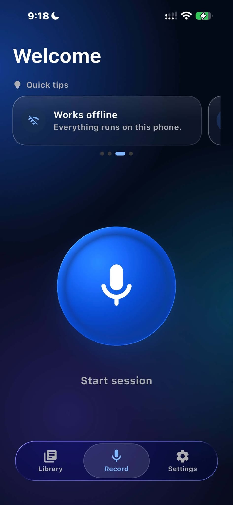 | 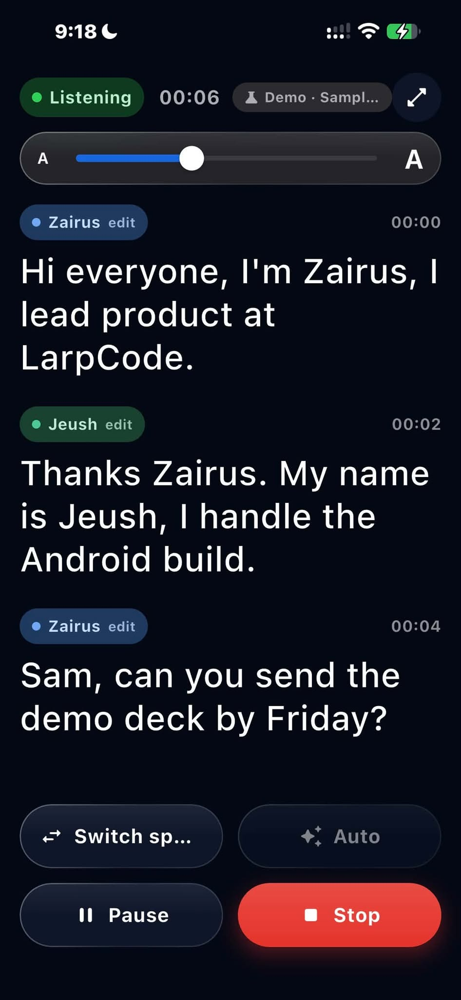 | 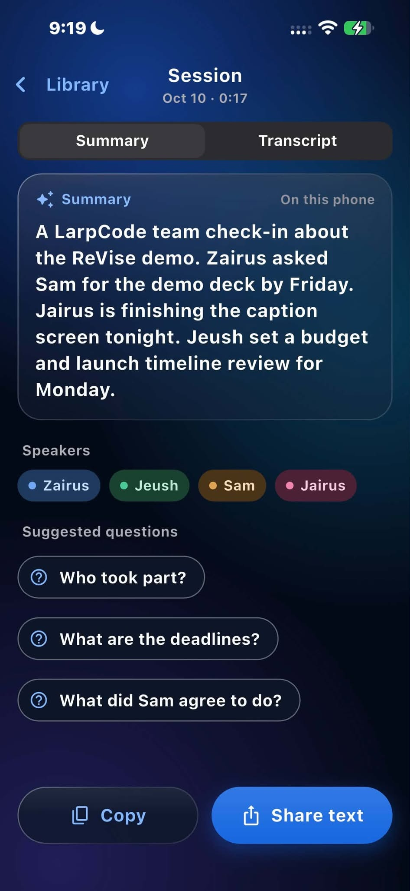 |

| Answers with sources | Clean transcript | Session Library |
| :---: | :---: | :---: |
| 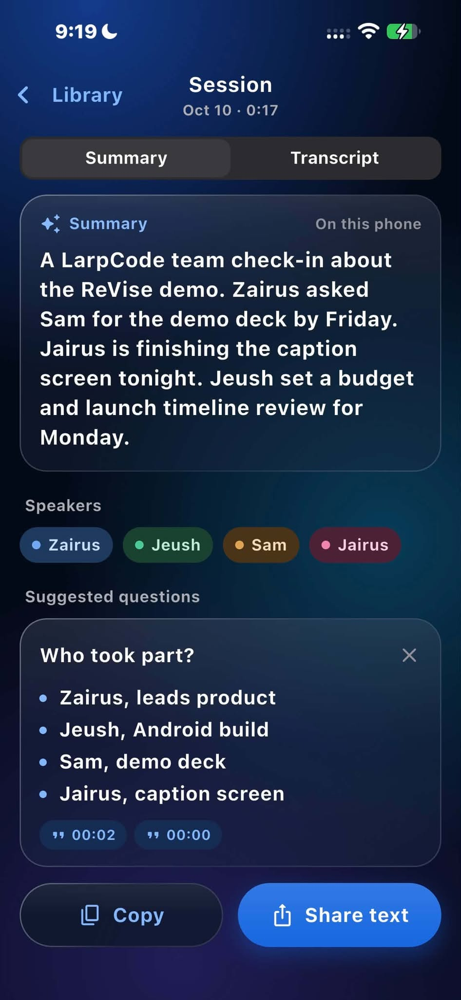 | 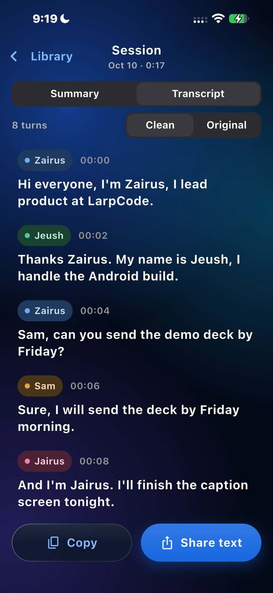 | 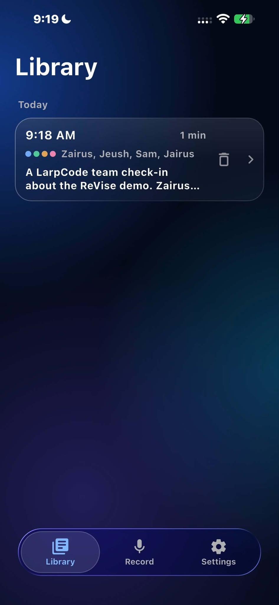 |

<details>
<summary>More screenshots</summary>

| Caption settings | Speaker turns | Summary progress |
| :---: | :---: | :---: |
| 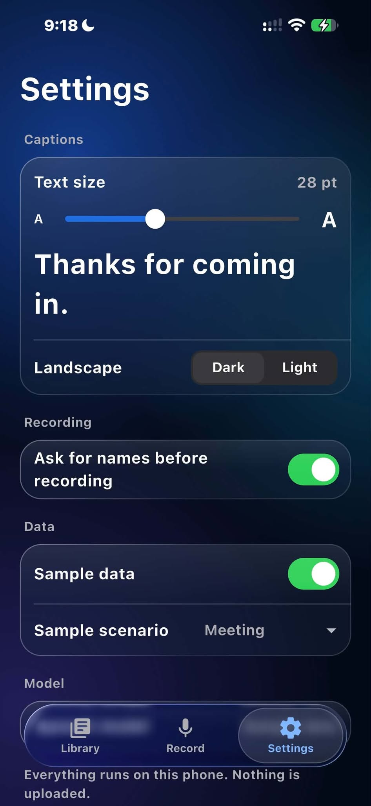 | 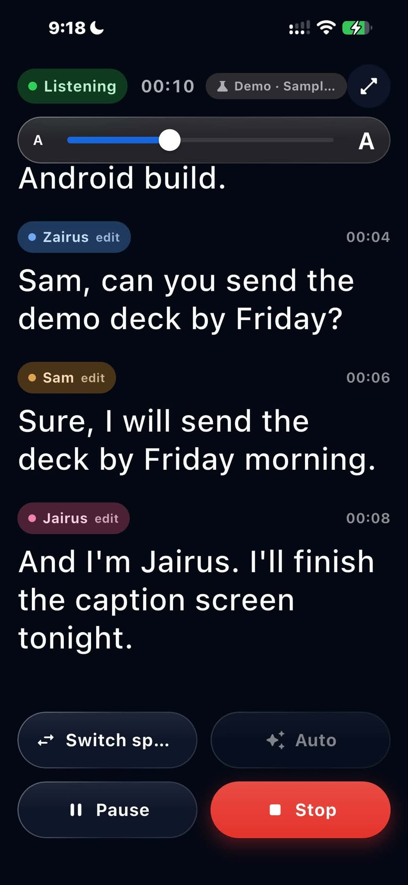 | 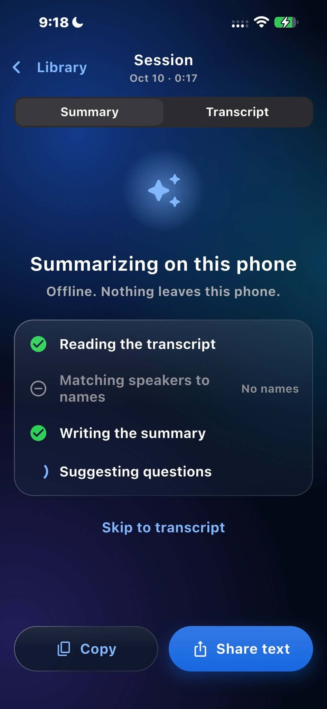 |

| Suggested answers | Answer sources | Empty Library |
| :---: | :---: | :---: |
| 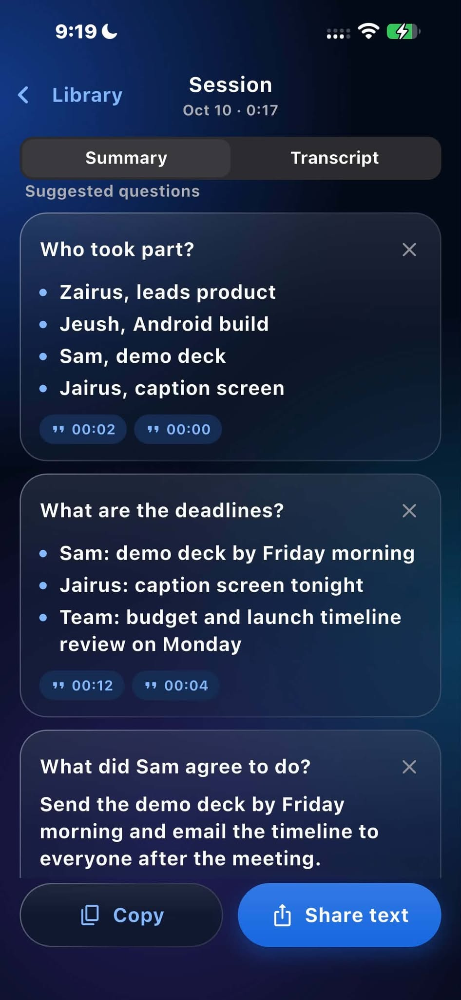 | 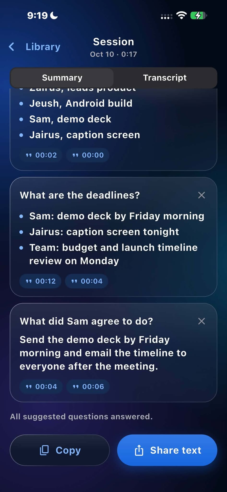 | 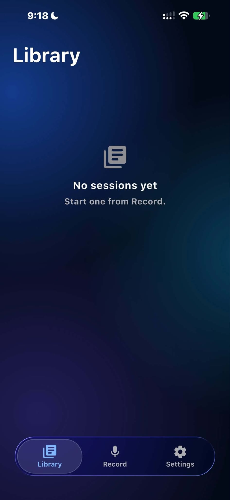 |

[App icon on the iPhone home screen](docs/screenshots/homescreen-icon.jpg)

</details>

## What runs locally—and what needs internet?

| Component | Where it runs | Internet required? |
| --- | --- | --- |
| Microphone capture, speech recognition and speaker identification | Native iOS engine on the phone | No, once the app is installed with its models |
| Transcript cleanup and speaker/name rules | Dart on the phone | No |
| Summary, question suggestions and Q&A | Qwen through llama.cpp on the phone | No |
| Library, settings and text display | Flutter/Dart on the phone | No |
| Sample data mode | Scripted mock engine on the phone | No; it does not run the real models |
| Dependency and model downloads | Developer machine during setup/build | Yes: Flutter packages, Swift packages/XCFramework and model assets |
| Demo video and LinkedIn post | YouTube and LinkedIn | Yes, to view the submission links |
| User-selected share destination | Chosen external app/service | Depends on the destination |

**No hosted inference API, account, API key or application backend is required.** The iOS model loader only checks bundled files; missing models produce an error rather than triggering a runtime download.

## Models and technology stack

### AI models and runtimes

| Purpose | Model/runtime used in the iOS build |
| --- | --- |
| Streaming speech-to-text | **Moonshine Voice Small Streaming, English**, through `moonshine-swift` 0.1.5 |
| Speaker identification | **Moonshine diarization-community1** assets: `segmentation.ort` and `embedding.ort` |
| Summary and Q&A | **Qwen2.5-1.5B-Instruct**, Q4_K_M GGUF (`qwen2.5-1.5b-instruct-q4_k_m.gguf`, approximately 1.1 GB) |
| Local LLM execution | **llama.cpp b11531**, bundled XCFramework with Apple Metal acceleration |

The model-download script offers other Qwen sizes for experimentation; the submission documents the default **1.5B Q4_K_M** model. Gemma is not used by the working iOS implementation.

### Frameworks and libraries

- **Flutter and Dart:** interface, session state, prompts, output validation and transcript processing. `pubspec.yaml` requires Dart **3.13.5 or newer within 3.x**.
- **Swift and Apple audio APIs:** native iOS microphone capture and inference integration; iOS deployment target **15.0**.
- **Flutter platform channels:** text/events through `revise/captions`; commands through `revise/engine`.
- **`share_plus`:** user-initiated text sharing.
- **`liquid_glass_renderer`, Cupertino and Material components:** interface styling.
- **Kotlin/Android:** shared-app shell and channel contract; native AI integration remains unfinished.

## Technical architecture

```text
Microphone → native Moonshine engine → caption + speaker events → Flutter UI
                                                                  │
                                                  Original / Clean transcript
                                                                  │ Stop
                                              Qwen + llama.cpp on the phone
                                                                  │
                                                Summary + cited conversation Q&A
```

Speech and LLM processing are staged: the LLM runs only while capture is stopped. A shared generation lock prevents competing LLM requests.

```text
lib/
├── app/          App settings and in-memory session Library
├── engine/       Native channel contract, LLM lock and sample-data engine
├── session/      Caption state, speaker labels, name rules and speaker splitting
├── transcript/   Rule-based transcript cleanup
├── ai/           Meeting AI prompts, parsing and evidence validation
├── summary/      Summary, suggestions and conversation Q&A controller
└── ui/           Record, captions, Library, settings and session screens
ios/              Flutter Runner and Swift channel plugin
ios-native/       Moonshine engine, llama.cpp integration and model-fetch script
android/          Android shell with unfinished native inference hooks
test/             Flutter/Dart unit, integration-style and UI tests
docs/screenshots/ Submission interface screenshots
```

### Keeping a small model grounded

JSON grammars constrain structured output and citation IDs. Dart validates answers against transcript words, checks invented names, filters questions out of summary prose, and requires evidence before applying model-suggested speaker names. Greedy decoding and decode-recovery paths help keep generation predictable.

These checks reduce unsupported output; **they do not guarantee correct summaries or attribution**. The original transcript remains available for review.

## Installation and setup

### Prerequisites

- Flutter with a bundled Dart SDK satisfying `^3.13.5`.
- For native iOS AI: a Mac with Xcode, Python 3, an Apple signing team and a **physical iPhone**. The pinned llama.cpp XCFramework has no iOS simulator slice.
- Internet on the developer machine for dependencies and the initial model download. Model assets are not committed to Git.

### Clone and test

```sh
git clone https://github.com/jeushdev/revoice.git
cd revoice
flutter pub get
flutter test
```

### Run the native iOS app

From the repository root on your Mac:

```sh
sh ios-native/fetch-models.sh
sh tool/set_ios_target.sh main
open ios/Runner.xcworkspace
```

The download script populates `ios-native/Models/` with speech, speaker and Qwen model files. Xcode bundles them into Runner.

1. In Xcode, choose the **Runner** scheme and a physical iPhone, then set your signing team.
2. Run the app. The committed scheme uses **Release** for Run with Metal validation disabled; Debug is substantially slower for LLM generation.
3. Grant microphone permission and turn **Settings → Sample data off**. Sample data is **on by default**.
4. Start a conversation, optionally enter names, speak, then tap **Stop** for the summary and Q&A.
5. For an offline check, disable Wi-Fi and mobile data and repeat with Sample data off.

If Flutter reports “Application not configured for iOS,” check the active Xcode developer directory:

```sh
sudo xcode-select -s /Applications/Xcode.app/Contents/Developer
```

### Explore the interface without real models

```sh
flutter run
```

Use a configured iOS/Android target and leave **Settings → Sample data on**. This replays a labeled scripted conversation with mock AI responses. It is useful for reviewing the UI but is not a live-AI demonstration. Android currently requires this mode for the complete app flow.

### Optional real-model check on a Mac

```sh
cd ios-native/MacLlmTest
swift build
cd ../..
E2E_LLM=1 flutter test test/e2e_mac_summary_test.dart
```

This runs the real LLM code against a scripted transcript; it does not test microphone capture or establish iPhone performance. See [native development notes](ios-native/README.md).

## Known limitations

- **English only.** Taglish and other speech languages are not supported in this submission.
- **No persistent Library yet.** Closing/restarting the app loses sessions and settings; export important text first.
- **Speaker attribution is fallible.** Automatic diarization and post-Stop splitting can merge or mislabel speakers. Manual corrections are available.
- **Small-model output needs review.** Summaries can misattribute commitments, and action-item detection is unreliable.
- **Long conversations are truncated for AI.** Summary and Ask use roughly the last 7,000 characters, not an unlimited full-session context.
- **Performance is device-dependent.** Stage-phone caption latency, summary time and peak memory have not been documented as measured benchmarks. The longer voice-detector window also affects line timing.
- **Android native inference is unfinished.** Do not treat the shared UI or sample mode as Android AI support.
- **CRM cards, audio re-transcription and LLM transcript polishing are not submission features.** Some historical planning documents and internal code refer to them.

## Team LarpCode

| Member | Development responsibility |
| --- | --- |
| **Jairus Macabuhay** | Flutter UI and shared Dart logic |
| **Zairus Jay Opinion** | Native iOS engine, on-device AI integration and iOS builds |
| **Jeush** ([@jeushdev](https://github.com/jeushdev)) | Android native development |
| **Samuel Ordiales** | Android LLM development and submission documentation |

## Disclosures and acknowledgments

### Existing code and assets

ReVoice integrates existing **Moonshine Voice**, **Qwen2.5**, **llama.cpp**, Flutter and the packages declared in [`pubspec.yaml`](pubspec.yaml) / [`pubspec.lock`](pubspec.lock). We did not train the speech, speaker or language models. The repository supplies the app interface, platform integration, session logic, prompts, validation and transcript rules. Sample conversations/responses are project-provided fixtures, not live AI output. Screenshots are provided by the team; the app icon/brand asset is included in the repository.

- **Qwen2.5-1.5B-Instruct-GGUF:** [Apache 2.0 model license](https://huggingface.co/Qwen/Qwen2.5-1.5B-Instruct-GGUF/blob/main/LICENSE).
- **llama.cpp b11531:** [MIT license](https://github.com/ggml-org/llama.cpp/blob/b11531/LICENSE).
- **Moonshine Voice:** [upstream license and model exceptions](https://github.com/moonshine-ai/moonshine/blob/main/LICENSE). Confirm the notices applicable to the downloaded speech and diarization assets before redistributing bundled model binaries.
- Third-party packages retain their own licenses. This repository does not currently include a project-wide `LICENSE` file; no additional license grant is implied here.

### AI development tools

The team used **Claude Code (Anthropic)**, **OpenAI Codex**, **Claude Design**, and **OpenCode**. This README/repository cleanup was assisted by **OpenCode with GPT-6.1 Sol (OpenAI)**. These are development/design tools, not cloud services called by the running app.

## Notes for judges

- **Project:** ReVoice — offline live captions and on-device conversation intelligence.
- **Demo video:** [YouTube](https://www.youtube.com/watch?v=KkFTXzSQAEE).
- **Social video/post URL:** [LinkedIn](https://lnkd.in/p/g9My36rK).
- **Repository:** [jeushdev/revoice](https://github.com/jeushdev/revoice), submission code on `main` sourced from `zrs/ios`.
- **Local vs internet requirements, models, frameworks, APIs/services, reused assets and AI tools:** disclosed above.
- **Review guidance:** use a bundled-model iOS build with **Sample data off** to evaluate native AI. Screenshots and Sample data show the scripted UI flow only.

Further details: [submission notes](SUBMISSION.md) · [demo script](DEMO.md) · [developer handoff](HANDOFF.md) · [original PRD](PRD.md). The PRD is historical: it uses the old name and includes features dropped from the final build. This README describes the current submission scope.
